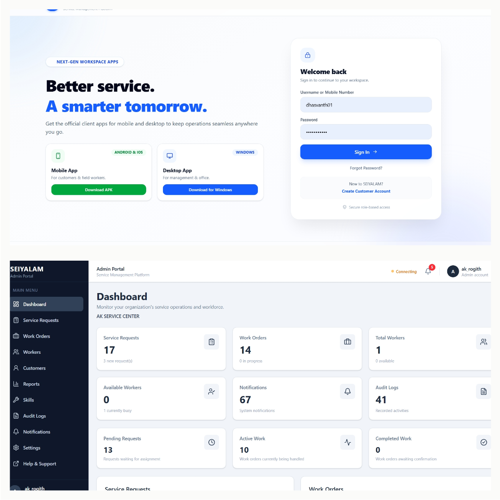

# SEIYALAM — Service Management Platform

<p align="center">
  <a href="https://seiyalam.netlify.app">
    
  </a>
  <a href="https://github.com/Rogith01/SEIYALAM">
    
  </a>
</p>

<p align="center">
  A full-stack service management platform connecting administrators, workers, and customers through a unified web and mobile experience.
</p>

<p align="center">
  <!-- Replace this path with your actual screenshot after uploading it to GitHub -->
  
</p>

<p align="center">
  
  
  
  
  
  
  
</p>

---

## 📌 Overview

**SEIYALAM** is a full-stack service management platform designed to help businesses organize service requests, manage workers, coordinate work orders, and track service progress.

The platform brings together a Django REST API backend, a React web application, a React Native mobile application, and an Electron-based Windows desktop client for supported workflows.

Its role-based design separates access for founders, administrators, workers, and customers, helping each user manage the tasks relevant to their responsibilities.

## ✨ Key Features

### 👥 User and Company Management
- Role-based access for Founder, Admin, Worker, and Customer.
- Company-oriented service management.
- Worker and customer management.
- Authentication and permission-controlled API access.

### 🛠️ Service Operations
- Create and manage customer service requests.
- Organize work through work orders.
- Assign work to workers.
- Track service and work order progress.
- Maintain work-related activity records.

### 📱 Multi-Platform Access
- React-based web application.
- React Native and Expo mobile application.
- Electron-based Windows desktop application.
- Shared backend API for supported application workflows.

### 🔔 Supporting Capabilities
- Notification-related functionality.
- REST API communication using JSON.
- Database-backed application data.
- Separate workflows based on user roles.

*Features and access depend on the current implementation and the permissions assigned to each role.*

## 🛠️ Technology Stack

| Component | Technology |
|---|---|
| Backend | Python, Django |
| API | Django REST Framework |
| Web frontend | React, JavaScript |
| Mobile application | React Native, Expo |
| Desktop application | Electron |
| Database | MySQL-compatible database; TiDB Cloud is part of the project setup |
| API communication | REST, JSON |
| Authentication | Token-based authentication and role-based permissions |
| Backend hosting | Render |
| Website hosting | Netlify |
| Version control | Git, GitHub |

## 🏗️ System Architecture

```text
┌─────────────────────┐
│   React Web App     │
└──────────┬──────────┘
           │
┌─────────────────────┐
│ React Native / Expo │
│    Mobile App       │
└──────────┬──────────┘
           │
┌─────────────────────┐
│ Electron Desktop    │
│    Application      │
└──────────┬──────────┘
           │
           ▼
┌─────────────────────┐
│   Django REST API   │
│ Authentication      │
│ Business Logic       │
│ Permissions          │
└──────────┬──────────┘
           │
           ▼
┌─────────────────────┐
│ MySQL-Compatible DB │
│ Application Data    │
└─────────────────────┘
```

The web, mobile, and desktop clients communicate with the backend for supported operations. The Django backend processes requests, enforces permissions, and interacts with the configured database.

## 🌐 Project Links

| Resource | Link |
|---|---|
| Live website | [seiyalam.netlify.app](https://seiyalam.netlify.app) |
| Backend API | [seiyalam.onrender.com/api](https://seiyalam.onrender.com/api) |
| GitHub repository | [Rogith01/SEIYALAM](https://github.com/Rogith01/SEIYALAM) |

## 🚀 Getting Started

Follow these steps to set up the project locally.

### Prerequisites

Install the following tools:

- Python 3.12 or a compatible version.
- Node.js and npm.
- Git.
- MySQL or a compatible database service.
- Expo tooling for mobile development.

### 1. Clone the Repository

```bash
git clone https://github.com/Rogith01/SEIYALAM.git
cd SEIYALAM
```

### 2. Set Up the Python Backend

Create a virtual environment:

**Windows PowerShell**

```powershell
python -m venv venv
.\venv\Scripts\Activate.ps1
```

Install the backend dependencies:

```powershell
pip install -r requirements.txt
```

### 3. Configure Environment Variables

Configure the database connection and required Django security and authentication settings using environment variables.

Example database variables:

```env
DB_NAME=your_database_name
DB_USER=your_database_user
DB_PASSWORD=your_database_password
DB_HOST=your_database_host
DB_PORT=3306
```

Replace the example values with your own configuration. The application must have a compatible database available before running migrations.

**Security:** Never commit real passwords, Django secret keys, access tokens, or private database connection strings to GitHub.

### 4. Apply Database Migrations

From the repository root, run:

```powershell
python manage.py migrate
```

### 5. Start the Backend Server

```powershell
python manage.py runserver
```

The local Django server will normally be available at:

`http://127.0.0.1:8000/`

The API is available under `/api` where configured by the project.

### 6. Run the Web Frontend

Open a separate terminal:

```powershell
cd frontend
npm install
npm run dev
```

Open the local development URL displayed by Vite.

### 7. Run the Mobile Application

Open another terminal:

```powershell
cd mobile
npm install
npx expo start
```

Follow the Expo instructions to run the application on a compatible Android device or emulator.

### Desktop Application

The Windows desktop client is built using Electron. Its development and installer commands depend on the scripts configured in `frontend/package.json`.

For the current project, the production Windows installer can be built from the frontend directory using:

```powershell
npm run electron:build
```

*Local setup may require additional environment variables, dependencies, or configuration based on the current repository. Configure the API base URL correctly for each application.*

## 🔐 Security Best Practices

- Keep environment files containing secrets out of version control.
- Use environment variables for deployment-specific configuration.
- Enforce permissions on protected API endpoints.
- Use HTTPS for deployed services.
- Use test data instead of personal customer information in demonstrations.
- Never publish credentials or private database connection URLs.

## 🗺️ Future Enhancements

Potential areas for future development include:

- Enhanced reporting and analytics.
- Additional notification and communication options.
- Improved mobile workflows.
- Integrations with external services.
- AI-assisted service management and automation.

These are potential enhancements, not claims that the functionality is already implemented.

## 👨‍💻 Author

**Rogith A**

- GitHub: [@Rogith01](https://github.com/Rogith01)
- Project: [SEIYALAM](https://github.com/Rogith01/SEIYALAM)

---

<p align="center">
  Built to make service operations more organized, connected, and manageable.
</p>
