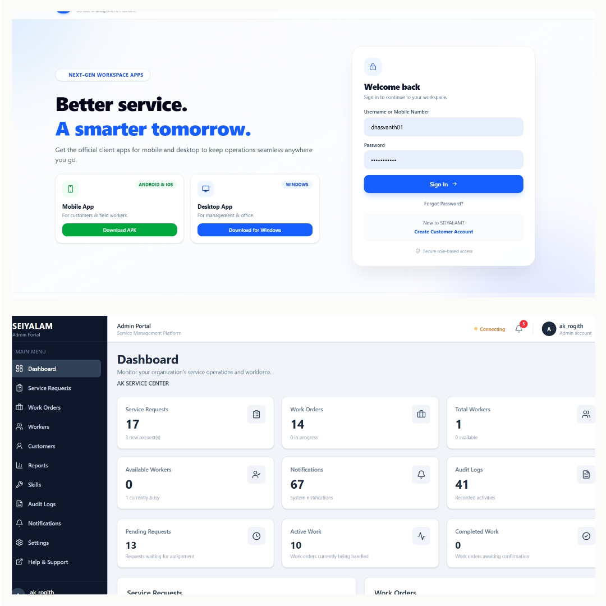

# SEIYALAM — AI-Powered Service Management Platform

<p align="center">
  <a href="https://seiyalam.netlify.app">
    
  </a>
  <a href="https://github.com/Rogith01/SEIYALAM">
    
  </a>
  <a href="https://github.com/Rogith01/SEIYALAM/releases">
    
  </a>
</p>

<p align="center">
  An AI-powered, full-stack service management platform connecting founders, administrators, workers, and customers through unified web, mobile, and Windows desktop applications.
</p>

<p align="center">
  <!-- Replace with your actual screenshot after uploading it to GitHub -->
  
</p>

<p align="center">
  
  
  
  
  
  
  
  
  
</p>

---

## 📌 Overview

**SEIYALAM** is a full-stack, AI-powered service management platform designed to help businesses organize customer service requests, manage workers, coordinate work orders, and monitor service progress.

The platform provides a unified ecosystem consisting of:

- Django REST API backend.
- React-based web application.
- React Native and Expo mobile application.
- Electron-based Windows desktop application.
- AI-powered chatbot using Large Language Models (LLMs) and Retrieval-Augmented Generation (RAG).

Its role-based architecture separates access for founders, administrators, workers, and customers, allowing each user to manage operations according to their responsibilities.

SEIYALAM also includes application update mechanisms for Android and Windows, helping users receive newer application versions without repeatedly downloading and installing updates manually.

## ✨ Key Features

### 👥 User and Company Management

- Role-based access for Founder, Admin, Worker, and Customer.
- Company-oriented service management.
- Worker and customer management.
- Authentication and permission-controlled API access.
- Separate workflows based on user roles.

### 🛠️ Service Operations

- Create and manage customer service requests.
- Organize service activities through work orders.
- Assign work to workers.
- Track service and work order progress.
- Maintain work-related activity records.
- Support evidence and work-related updates.

### 🤖 AI-Powered Chatbot

SEIYALAM incorporates an AI-powered chatbot designed to provide intelligent, context-aware assistance.

**AI technologies:**

- Large Language Models (LLMs) for natural-language understanding and response generation.
- Retrieval-Augmented Generation (RAG) for retrieving relevant information before generating responses.
- Context-aware question answering.
- Retrieval-based knowledge assistance.
- Natural-language interaction through a conversational interface.

**How RAG works:**

1. A user submits a question through the chatbot.
2. The system retrieves relevant information from its available knowledge sources.
3. Retrieved context is provided to the LLM.
4. The LLM generates a response using the retrieved context.

This approach helps the chatbot provide responses grounded in relevant information rather than relying entirely on the model's pre-trained knowledge.

### 📱 Multi-Platform Access

- React-based web application.
- React Native and Expo Android application.
- Electron-based Windows desktop application.
- Shared Django REST API for supported application workflows.
- Role-based access across supported platforms.

### 🔄 Application Auto-Updates

SEIYALAM includes update mechanisms for both Android and Windows applications.

**Android APK Auto-Update**

- Android application version checking.
- GitHub-hosted release manifest.
- New APK availability detection.
- In-app update notification.
- APK download and Android installation flow.
- Version-based update management.

**Windows Desktop Auto-Update**

- Electron-based update mechanism using `electron-updater`.
- GitHub Releases integration.
- New version detection.
- Update download and installation workflow.
- Application updates without requiring users to manually download every new installer.

The update process requires user confirmation where the operating system or installer requires it.

### 🔔 Supporting Capabilities

- Notification-related functionality.
- REST API communication using JSON.
- Database-backed application data.
- Token-based authentication.
- Role-based permissions.
- Cross-platform service workflows.

*Features and access depend on the current implementation and the permissions assigned to each role.*

---

## 🛠️ Technology Stack

| Component | Technology |
|---|---|
| Backend | Python, Django |
| API | Django REST Framework |
| Web frontend | React, JavaScript |
| Mobile application | React Native, Expo |
| Desktop application | Electron |
| Database | MySQL-compatible database, TiDB Cloud |
| AI integration | Large Language Models (LLMs) |
| AI architecture | Retrieval-Augmented Generation (RAG) |
| API communication | REST, JSON |
| Authentication | Token-based authentication |
| Android updates | Custom GitHub-based APK updater |
| Windows updates | Electron `electron-updater` |
| Backend hosting | Render |
| Website hosting | Netlify |
| Version control | Git, GitHub |
| Android builds | Expo Application Services (EAS) |

---

## 🏗️ System Architecture

```text
                  SEIYALAM ECOSYSTEM
                           |
        +------------------+------------------+
        |                  |                  |
   React Web App      Expo Mobile App    Electron Desktop
        |                  |                  |
        +------------------+------------------+
                           |
                           v
                  Django REST API
                           |
        +------------------+------------------+
        |                  |                  |
 Authentication     Business Logic       Permissions
        |                  |                  |
        +------------------+------------------+
                           |
              +------------+------------+
              |                         |
              v                         v
       MySQL-Compatible DB         AI Chatbot
                                        |
                                        v
                                  RAG Retrieval
                                        |
                                        v
                                 LLM Integration
                                        |
                                        v
                               Contextual Response
```

### Application Update Architecture

```text
             GitHub Releases
                    |
          +---------+---------+
          |                   |
          v                   v
    Android APK         Windows Installer
          |                   |
          v                   v
    Android Updater     Electron Updater
          |                   |
          v                   v
    Download APK       Download Update
          |                   |
          v                   v
    Android Installer  Install / Restart
```

The web, mobile, and desktop clients communicate with the backend for supported operations. The Django backend processes requests, enforces permissions, and interacts with the configured database.

The AI chatbot uses an LLM and retrieval-based context to support conversational assistance.

---

## 🌐 Project Links

| Resource | Link |
|---|---|
| Live website | [seiyalam.netlify.app](https://seiyalam.netlify.app) |
| Backend API | [seiyalam.onrender.com/api](https://seiyalam.onrender.com/api) |
| GitHub repository | [Rogith01/SEIYALAM](https://github.com/Rogith01/SEIYALAM) |
| Application releases | [GitHub Releases](https://github.com/Rogith01/SEIYALAM/releases) |

---

## 🚀 Getting Started

Follow these steps to set up the project locally.

### Prerequisites

Install the following tools:

- Python 3.12 or a compatible version.
- Node.js and npm.
- Git.
- MySQL or a compatible database service.
- Expo tooling for mobile development.

### 1. Clone the Repository

```bash
git clone https://github.com/Rogith01/SEIYALAM.git
cd SEIYALAM
```

### 2. Set Up the Python Backend

Create a virtual environment:

**Windows PowerShell**

```powershell
python -m venv venv
.\venv\Scripts\Activate.ps1
```

Install backend dependencies:

```powershell
pip install -r requirements.txt
```

### 3. Configure Environment Variables

Configure the database connection and required Django security and authentication settings using environment variables.

Example database variables:

```env
DB_NAME=your_database_name
DB_USER=your_database_user
DB_PASSWORD=your_database_password
DB_HOST=your_database_host
DB_PORT=3306
```

Replace the example values with your own configuration. The application must have a compatible database available before running migrations.

**Security:** Never commit real passwords, Django secret keys, access tokens, or private database connection strings to GitHub.

### 4. Apply Database Migrations

From the repository root:

```powershell
python manage.py migrate
```

### 5. Start the Backend Server

```powershell
python manage.py runserver
```

The local Django server will normally be available at:

```text
http://127.0.0.1:8000/
```

The API is available under `/api` where configured by the project.

### 6. Run the Web Frontend

Open a separate terminal:

```powershell
cd frontend
npm install
npm run dev
```

Open the local development URL displayed by the frontend development server.

### 7. Run the Mobile Application

Open another terminal:

```powershell
cd mobile
npm install
npx expo start
```

Follow the Expo instructions to run the application on a compatible Android device or emulator.

### 8. Build the Windows Desktop Application

The Windows desktop client is built using Electron.

From the frontend directory:

```powershell
cd frontend
npm install
npm run electron:build
```

The production build generates the Windows installer according to the Electron Builder configuration.

*Local setup may require additional environment variables, dependencies, or configuration based on the current repository. Configure the API base URL correctly for each application.*

---

## 📦 Application Releases and Updates

SEIYALAM supports separate release workflows for Android and Windows.

### Android APK Release

Android production APKs are built using Expo Application Services.

From the mobile directory:

```powershell
eas build --platform android --profile production
```

After a successful build:

1. Download the generated APK.
2. Rename it to `SEIYALAM-Android.apk`.
3. Create a new Android GitHub Release.
4. Upload the APK asset.
5. Update `mobile/android-latest.json` with the new version, APK URL, and release notes.
6. Commit and push the updated manifest to GitHub.

The installed Android application checks the hosted manifest and can notify users when a newer version is available.

### Windows Desktop Release

Windows desktop releases use Electron Builder and `electron-updater`.

The update process integrates with GitHub Releases to distribute new application versions to existing Windows installations.

Android and Windows releases use separate release workflows and can be managed independently.

**Important:** Existing installations must use compatible application signing credentials and update configurations for successful upgrades.

---

## 🔐 Security Best Practices

- Keep environment files containing secrets out of version control.
- Use environment variables for deployment-specific configuration.
- Enforce permissions on protected API endpoints.
- Use HTTPS for deployed services.
- Use test data instead of personal customer information in demonstrations.
- Never publish credentials or private database connection URLs.
- Protect AI service credentials and API keys.
- Validate and restrict access to sensitive information used by the chatbot.

---

## 🗺️ Future Enhancements

Potential areas for future development include:

- Enhanced reporting and analytics.
- Additional notification and communication options.
- Improved mobile workflows.
- More external service integrations.
- Advanced AI-assisted service management.
- Improved chatbot knowledge retrieval and evaluation.
- Additional workflow automation.

These are potential enhancements, not claims that the functionality is already implemented.

---

## 👨‍💻 Author

**Rogith A**

- GitHub: [@Rogith01](https://github.com/Rogith01)
- Project: [SEIYALAM](https://github.com/Rogith01/SEIYALAM)

---

<p align="center">
  Built to make service operations smarter, more organized, connected, and manageable.
</p>
